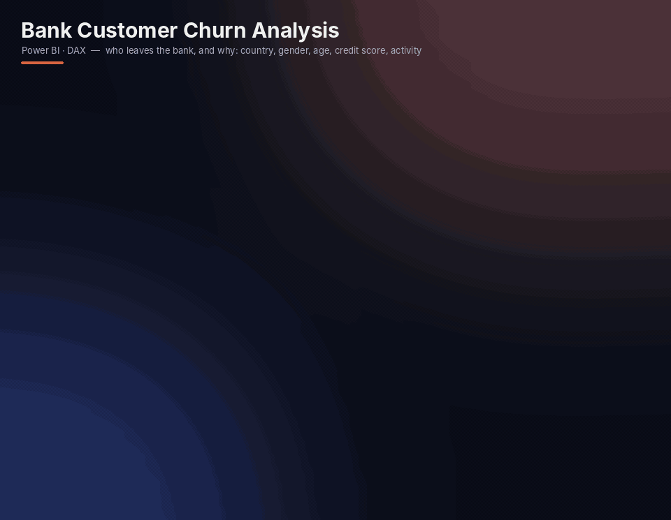
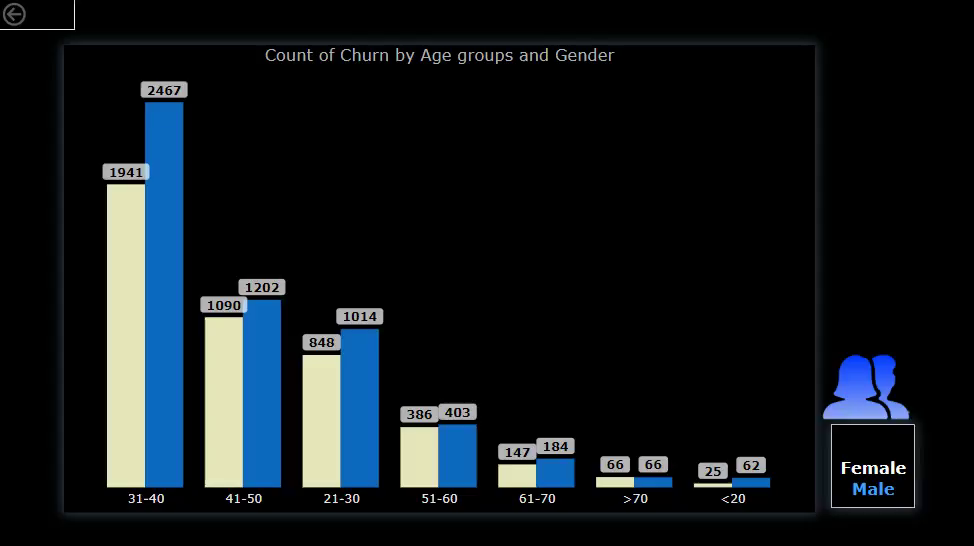

# 🏦 Bank Customer Churn Analysis

  

A dark-themed, interactive Power BI dashboard that shows **which bank customers leave, and why**: churn by country, gender, age group, credit score, card ownership and activity status.

## 📸 Dashboard

🔍 [View full-resolution static screenshot](images/dashboard.png) · 🎬 [Watch the full demo video](bank-customer-churn-analysis-demo.mp4)

## ❓ Business questions

- How many customers does the bank have, and how many have left?
- Which countries, genders and age groups churn the most?
- Does credit score affect the likelihood of leaving?
- Are active members and credit card holders more loyal?

## 🗂 Data

Customer-level banking data (≈10K customers): country, gender, age, credit score, credit card ownership, active membership and churn flag.

## 📊 What's inside

- **KPI cards**: total customers, lost customers, churn rate
- **Customers by Country**: treemap (France, Germany, Spain)
- **Donuts**: gender split, active vs inactive members, credit card holders, churned vs unchurned
- **Combo charts**: customer count + churn rate by **age group** and by **credit score range**
- **Drill-through page**: churn by age group and gender, with a custom gender toggle
- Every visual cross-filters, so clicking a country, gender or segment updates the whole page

## 🔢 Headline KPIs

| Total customers | Lost customers | Churn rate |
|---|---|---|
| 9,901 | 2,021 | 20.41% |

## 💡 Key insights

- **Germany** has the highest churn: its churn rate is much higher than France's or Spain's, even though it has about half as many customers as France.
- **The 51–60 age group** has the highest churn rate. The 31–40 group is the largest segment, but it is relatively loyal.
- Customers with **very low credit scores (≤400)** churn at close to 100%.
- **Inactive members** churn noticeably more than active ones, so engagement is a key retention lever.
- Male customers make up 54.5% of the base and female customers 45.5%. Filtering shows female customers churn at a higher rate.

## 🧠 Skills demonstrated

- Dashboard design and visual storytelling (dark theme, custom icons)
- DAX measures for counts, churn rate and percentages
- Combo charts with dual axes, treemaps, donuts and drill-through navigation
- Interactive cross-filtering for root-cause analysis

## 🚀 How to view

The animated preview above and the [demo video](bank-customer-churn-analysis-demo.mp4) show the dashboard in action.

---

**Built by [Ali Isa Ashrafli](https://www.linkedin.com/in/ali-isa-ashrafli-8995a619b/)** · Data Analyst · Baku, Azerbaijan

⭐ If you find this project useful, consider giving it a star!
